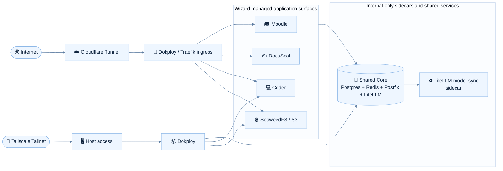
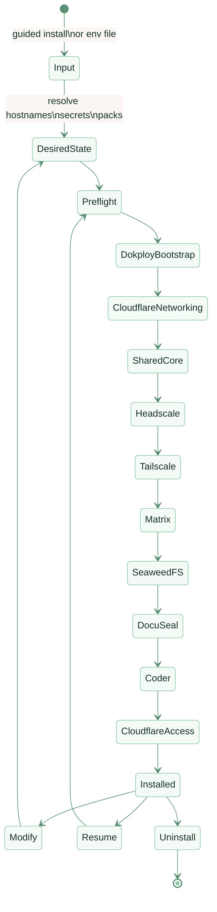
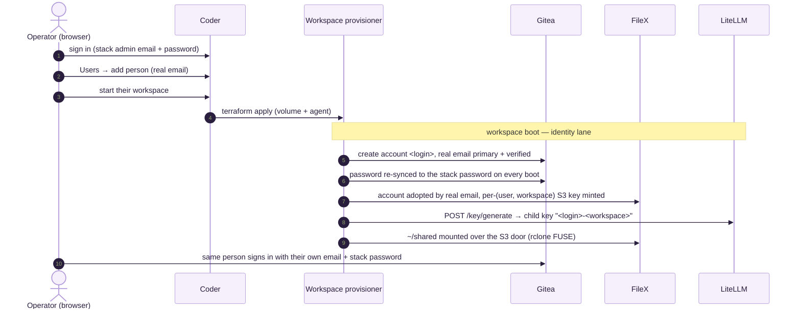
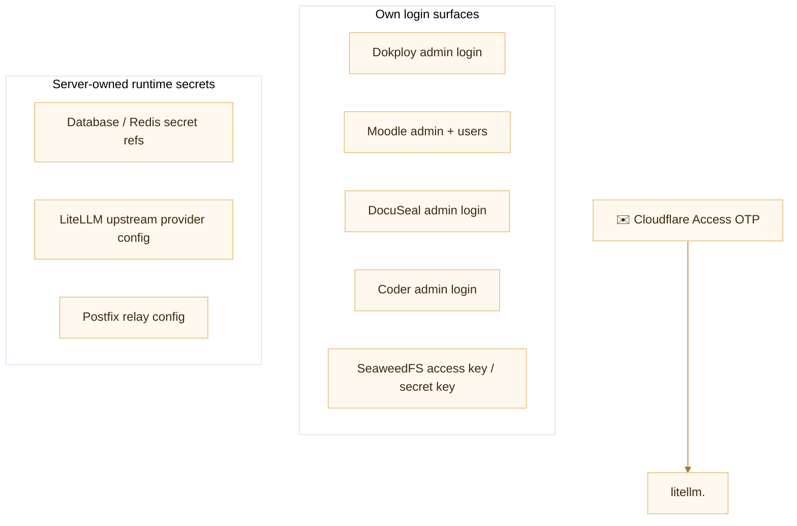

# Dokploy Wizard

Dokploy Wizard is a Python-first installer for standing up a real self-hosted stack on a fresh Ubuntu VPS with Dokploy, Cloudflare Tunnel, optional Cloudflare Access, optional Tailscale host access, and a set of opinionated application packs.

Today this repo is not a scaffold or mock planner. It performs real deployment, real rerun/modify/uninstall flows, and has been validated on fresh VPS rebuilds.

## What it installs

- **Dokploy** as the deployment control plane
- **Cloudflare Tunnel** for public ingress
- **Cloudflare Access** OTP on the LiteLLM admin surface
- **Tailscale** for optional private/admin host access
- **Shared Core** services used by packs
  - PostgreSQL
  - Redis
  - Postfix mail relay
  - LiteLLM AI gateway
- **Moodle**
- **DocuSeal**
- **SeaweedFS** for S3-compatible object storage
- **FileX** lightweight web file manager, storing files in a wizard-owned SeaweedFS bucket, with in-browser editing through a bundled ONLYOFFICE DocumentServer sidecar on its own hostname
- **Gitea** self-hosted git hosting (rootless image, repos on its own volume, LFS/attachments in a wizard-owned SeaweedFS bucket)
- **Coder** with a single seeded Ubuntu + VS Code workspace template (Hermes Desktop)

Optional packs also include Headscale, Matrix, and Tailscale host access. FileX and Gitea require the SeaweedFS pack and turn it on automatically. The AI-advisor packs this repo once shipped (a browser/Telegram agent runtime with its embedded Talk assistant, the farm advisor, and the research/chat pack) were removed in code; the wizard still cleans their ledger entries up on uninstall for older boxes that ran them. The Nextcloud Files pack and its standalone ONLYOFFICE sidecar retired the same way: FileX — now with its own bundled editing sidecar — is the file story, and nextcloud-era ledger rows clean up on uninstall like the rest.

## The stack, as shipped

Every image below was captured from a live box by the screenshot studio in
`screenshots/` — real URLs, real logins, fail-closed auth checks — then
redacted deterministically (every rendered pixel of the real root domain, the
deployer login, and the deployer email gets a character-precise blur; the
caption spells it `«your-domain»`). `make all` on any proven box reproduces
the gallery. No mocks, no staging screenshots.

### The control plane

Login at `https://dokploy.<root-domain>/` (the form is served at the root path).


After login, on the dashboard: every wizard service is a Dokploy project — inspect and restart it by hand whenever you like.


### Coder — one template, one workspace per person

Login at `https://coder.<root-domain>/login` — the same email and password as
every other surface.


The wizard seeds one template and one default workspace; the dev box boots in
seconds.


App tiles ride the workspace: OpenCode, Hermes, Gitea, FileX, DocuSeal —
per-person, pre-authenticated.


The template is plain Terraform — the wizard bakes the box topology into it at
plan time.


Users page: the primary deployer account plus a joined second person — each
gets their own identity lane.


Workspace settings are the day-2 knobs — update policy first; schedule and TTL
controls sit alongside.


### A second person joins — the identity lane, end to end

Demo account signs in — the primary deployer account created it minutes before.


One workspace per person, from the one seeded template.


The identity lane springs again: the new account gets a Gitea account with its
own real email primary.


Gitea login at `https://gitea.<root-domain>/user/login`; the account page is
`/user/settings`. A workspace owner wakes up a Gitea account already theirs:
login name, real email primary and verified.


Emails are managed identities, not placeholders — the boot lane migrates
anything the pre-fix wizard left behind.


One deploy key pair per (user, workspace), titled by the pair — push over SSH,
nothing shared.


Every account on the box, listed: the people and nobody else — the wizard
provisions under the deployer's own login, so there is no service account to
audit.


Commits authored in the workspace land with the person, over their workspace
key.


Team Git, self-hosted — the pack provisions itself and the wizard keeps its
admin hat in a state file.


### `~/shared` — the file story in three images

Workspace A writes into `~/shared` — an ordinary file write over the FUSE
mount.


Workspace B sees the same bytes seconds later — one bucket, one identity map,
no sync daemon.


FileX login at `https://filex.<root-domain>/admin/login` — the deployer signs
in as the account the pack bootstrapped; nothing else to remember.


`~/shared` is FileX: versioned objects on SeaweedFS S3, mounted over rclone
FUSE.


Two people edit the same file; FileX keeps every version and every author —
this is where the act pays off.


The same bucket speaks S3 and WebDAV — official desktop and mobile clients
connect with the user's own key.


S3 keys are per (user, workspace) — the label names both, and the mount dies
with the workspace, not the person.


People page after a clean install: only humans — the deployer's own email and
the joined second person. The provisioner service account is gone; its lane
rides an admin-scope token on the admin itself.


### LiteLLM — one gateway, spend by name

Login at `https://litellm.<root-domain>/ui/login`.


Model autosync registers provider models as `sync/*` — including a tailnet
vLLM box named for the host that serves it.


Every app gets its own virtual key — `coder-hermes`, `dokploy-ai` — plus one
minted per (user, workspace), spend tracked per key.


A key carries its model allow-list; the team plan grants it, the box enforces
it.


Spend and tokens per key — who called which model, on whose box.


Request logs: every completion, keyed to the app and person that issued it.


New-user policy is a stack knob: models off by default, grants explicit, the
admin exempt.


### DocuSeal

Login at `https://docuseal.<root-domain>/sign_in` — forms and signatures on
your own metal.


Form builder, submissions, and audit trail; the wizard bootstraps the deployer
account.


### The tailnet

The box joins your tailnet on install — private host access, and private model
servers become reachable.


A tailnet vLLM/Ollama endpoint is a first-class sync source: models register
under the serving host's name.


### Day-2, from the terminal

`modify` re-runs the whole convergence loop — an unchanged box answers in
seconds, `mode: noop`.


`upgrade --check` is read-only: it tells you the pinned LiteLLM drifted and
what the bump would touch.


Uninstall is ledger-scoped: it removes what it owns, and a confirm file stands
between you and a typo.


## Current reality

- Fresh-VPS install works
- Same-host rerun / noop proof works
- fresh-VPS install, rerun, and inspect-state flows are part of the validation path
- SeaweedFS, Matrix, Moodle, DocuSeal, FileX, Gitea, and Coder are all part of the wizard-managed path
- Unchanged healthy services skip Dokploy update/deploy on rerun through compose artifact hash tracking

## High-level architecture



## Install and lifecycle flow



## What happens when a person joins

The one flow that ties the stack together: the operator adds a user in Coder,
and the workspace boot lane springs that person's identity through every other
pack. No manual account creation on four systems, no shared bot account.



Deleting the Coder user later disables exactly the Gitea accounts the wizard
sprung (the claim roster lives in the state directory as
`gitea-identities.json`) and never touches a manual one.

## What each major surface does

### Dokploy

Dokploy is the control plane the wizard targets for all compose app deployment. The wizard bootstraps Dokploy, mints or reuses an API key, and then uses that API key for all managed pack operations.

After LiteLLM is ready, the wizard also reconciles Dokploy's built-in AI provider rows. Dokploy stores one model per provider row, so the wizard seeds one row per model alias its `dokploy-ai` virtual key can invoke: the default row is named `Dokploy Wizard LiteLLM` and every additional alias gets a `Dokploy Wizard LiteLLM · <alias>` row, all pointing at the wizard-managed internal LiteLLM gateway with the dedicated `dokploy-ai` virtual key, not the LiteLLM master key. The Ask-AI picker therefore lists every gateway-visible model instead of just one, and rows outside the allowed alias set are removed on the next pass.

### Shared Core

Shared Core is the common substrate for packs that need databases, cache, mail relay, or AI gateway access. It is installed as core infrastructure before the optional application packs that depend on it.

Today Shared Core includes:

- **PostgreSQL** for Coder, Moodle, and other packs that need wizard-owned relational storage. The wizard keeps the pg16 pgvector image unchanged for continuity but no longer grants the vector extension, superuser role, or `wal_level=logical` that the retired advisor runtimes required.
- **Redis** for packs that need cache or queue backing.
- **Postfix** as the wizard-managed mail relay surface for services that need SMTP/mail delivery. It centralizes the relay endpoint inside the stack; it does not imply every application has complete mail workflows configured by default.
- **LiteLLM** as the central AI passthrough/gateway for wizard-managed services deployed through Dokploy.

These are wizard-owned resources, tracked in the ownership ledger, and reused across modify / rerun operations.

LiteLLM is the AI boundary for the stack. Services use the internal Docker-network URL `http://<stack-name>-shared-litellm:4000` and receive wizard-managed virtual keys or generated gateway defaults. Upstream provider keys terminate at LiteLLM instead of being copied into each application container. The public `litellm.<root-domain>` admin hostname exists for operator management and stays Cloudflare Access-protected; service-to-service traffic should stay on the shared internal network.

### Coder

Coder gets one seeded Ubuntu + VS Code template — Hermes Desktop — and a first default workspace. The default workspace keeps a stable name (`<root-token>-workspace`, derived from the Coder hostname): an earlier date-stamped name made every post-midnight rerun mint a second full Hermes stack. On the first pass after the fix, an existing legacy date-stamped workspace on the default template is adopted by rename, and leftover wizard-created dated duplicates are pruned — dated names on templates the wizard did not seed are left alone.

On first successful bootstrap the wizard:

- provisions the initial Coder admin
- pushes the seeded templates:

  | Template | What it provides |
  |---|---|
  | `ubuntu-vscode-hermes-desktop` | Ubuntu + VS Code with `curl`, `git`, `wget`, `btop`, `zellij`, OpenCode Web, the community Hermes WebUI, and the official Hermes Desktop webapp as its own tile |

  This is the only template the wizard seeds. The five predecessors it grew out of
  (`ubuntu-vscode`, `ubuntu-vscode-opencode-web`, `ubuntu-vscode-kdense-byok`,
  `ubuntu-vscode-hermes`, `ubuntu-vscode-opencode-hermes-pi`) are retired on the next
  pass, and any live workspace still riding one is re-based onto the survivor first:
  the workspace id survives, so the home volume — everything under `/home` — comes
  with it.

The Desktop tile opens with no sign-in of its own: the gateway binds `127.0.0.1`,
declares no public hostname (upstream ties a declared public URL to a second
login flow), and a loopback forwarder presents the tile port to Coder's proxy and
hands the browser the gateway's stored credential the way the Desktop app itself
would. The perimeter is: no published port, `127.0.0.1` bind, `share = "owner"` on
the Coder app, and Cloudflare Access in front — the page carries the credential to
exactly the browsers Coder has already authenticated.

Every wizard-managed template installs the OpenCode CLI and the Pi coding agent
(`@earendil-works/pi-coding-agent`) and pre-seeds OpenCode, Pi, and VS Code
Copilot BYOK with the full alias list resolved from the wizard-managed LiteLLM
gateway, so agents are pre-wired on first boot instead of waiting for manual
provider setup.

Each workspace also mints its own LiteLLM child key at boot (named
`<login>-<workspace>` from the wizard's issuer key), so spend attributes per
person and machine. Operator model access on those minted keys is opt-in for
new users: `ALLOW_LITELLM_MODELS_FOR_NEW_USERS` grants every owner the
operator's models, `ALLOWED_LITELLM_ADDITIONAL_USERS` names specific Coder
logins, and the seeded admin is always exempt. A denied owner still gets a
personal key — scoped to one sentinel model the gateway does not deploy — so
boot stays healthy and inference fails honestly at the gateway instead of
falling back to the shared template key. Flipping the policy reruns
`shared_core` and `coder`: the reconcile sweep re-scopes existing minted keys
admin-side (no workspace reboot needed), and future boots mint under the fresh
policy.

- creates a default workspace for the operator

Removed templates are retired automatically on the next wizard rerun or modify; workspaces still on a retired template are migrated in place before the delete.

That default template installs:

- `curl`
- `git`
- `wget`
- `btop`
- `opencode`
- `pi` (Pi coding agent CLI)
- `zellij`
- `fuse3` (for the `~/shared` mount below)

When the FileX pack is enabled, every workspace also gets **`~/shared`**: the
FileX bucket mounted as a live folder through an rclone FUSE mount over FileX's
own S3 door. It behaves as a window onto the bucket, never a clone of it — file
names are always visible, content is fetched on first open, and a disk-backed
hot cache on the home volume keeps only recently touched files (defaults: 10 G
cap, 48 h idle eviction, raisable at runtime with `shared-cache 20G`). The
mount, its supervisor, and the helpers bootstrap themselves in the background
at workspace start: any failure (account, network, FUSE) logs to
`/tmp/filex-shared.log` and leaves `~/shared` a plain folder — the workspace
never loses its boot over a mount. A wizard `modify` that changes the template
also brings the default workspace onto the new active template version
(`coder update`), so pushed changes land in running workspaces on the same
pass.

Attribution is per **(user, workspace)**: each workspace mints its own FileX
S3 key labeled `<login>-<workspace>`, owned by the workspace owner's own FileX
account (created lazily at first boot with a deterministic password derived
from the LiteLLM issuer key). The rclone remote is configured with
`provider = Other` deliberately: rclone's AWS-provider path computes a flexible
checksum from a seekable body and never sends the PUT to FileX's door
(measured on the box), while the Other provider signs plain PUTs the door
accepts, catalogues under the key's owner, and snapshots on overwrite. File
rows therefore record the person, the label names the machine, and
`shared-versions <path>` lists or `--restore <id>` rolls back history. A manually
created FileX account with the same name keeps its own secret — the mount then
skips instead of resetting a human's password. Every workspace, the admin's
included, rides the same rules. The wizard-managed service account behind all
of this is `wizard-provisioner` (admin role, `read,write,delete,admin` token:
FileX grants `/api/admin` delegation to signed-in sessions or admin-scoped
tokens only, and the token is the sole credential baked into the template —
workspace scripts immediately trade down to the owner's own credentials, which
never carry admin).

The workspace home directory lives on a per-workspace Docker volume. The control plane state lives in shared-core Postgres.

### Coder App Hostnames

The wizard supports two different ideas for how browser-facing Coder apps should be routed:

- The ideal Coder-native shape is `*.coder.<root-domain>`.
- The currently selected no-fee fallback is `*.<root-domain>` limited by a strict app-host pattern, so only Coder app-style hostnames route into Coder.

Why the fallback exists:

- Cloudflare Universal SSL on a full zone covers the zone apex and first-level subdomains.
- A hostname like `foo.coder.example.com` is a deeper subdomain and is not covered by Universal SSL.
- Cloudflare's supported paid fix is Advanced Certificate Manager, which can issue edge certificates for `*.coder.<root-domain>`.

Current decision:

- Keep the fallback `*.<root-domain>` for live installs until a future architecture change is chosen.
- Preserve a strict router pattern so service hosts like `dokploy.<root-domain>`, `gitea.<root-domain>`, and `moodle.<root-domain>` are not hijacked by Coder.

Future architecture options:

1. Keep the current fallback: lowest risk and already working. Coder app hosts look like `app--workspace--user.<root-domain>`.
2. Use `*.coder.<root-domain>` with Cloudflare Advanced Certificate Manager: closest to the Coder docs and cleanest hostname model, but requires ACM on the zone.
3. Keep `*.coder.<root-domain>` but move Coder off Cloudflare Tunnel: terminate public TLS directly in Dokploy/Traefik using DNS-01 wildcard certificates. This avoids the ACM fee but changes the ingress architecture for Coder.
4. Convert selected Coder apps to path-based routing: works without wildcard subdomain TLS, but app compatibility is weaker than subdomain routing and usually requires template-specific base-path work.

Operational note:

- Hermes and OpenCode Web are already path-based Coder apps in this repo.
- K-Dense BYOK (retired with the template collapse) was the outlier that used `subdomain = true`; the surviving template routes its apps by path, so wildcard app routing is optional.

### SeaweedFS

SeaweedFS provides the S3-compatible object-storage surface. The wizard wires:

- service + data volume
- generated access key + secret key in guided mode
- an internal-only S3 route on `<stack>-s3.internal` (traefik Host rule on the tunnel edge, reachable from cluster containers and from the host through the loopback edge)

The endpoint is deliberately not published on a public hostname: this deployment
has no S3 identity layer (the gateway itself is anonymous-by-default), so an open
`s3.<root-domain>` bucket would be an abuse magnet for anyone who finds it. On
boxes that ran the earlier public route, the next modify pass rebinds the service
onto the internal hostname and prunes the stale `s3.<root-domain>` DNS record.
Re-exposing S3 publicly is a future item that needs an identity/auth story first.

### FileX

FileX is a single-binary web file manager (browse, upload, share) that stores its
files in the SeaweedFS bucket the wizard owns. The wizard wires:

- service + data volume, exposed at `filex.<root-domain>`
- an ONLYOFFICE DocumentServer editing sidecar on its own hostname,
  `office.<root-domain>`, served at the root: FileX refuses an editor frame
  on its own origin (its config guard crash-looped the same-origin design the
  first time — measured), and docservice does not mount its statics under a
  subpath anyway, so the sidecar gets a clean origin instead of a pinned
  prefix. JWT is enforced between the app and the sidecar on a deterministic
  per-stack secret, recorded at `filex-office-jwt.json` (0600) in the state
  directory; the editing round-trip lands as ordinary versions in the same
  versioned bucket. The pass verifies the sidecar the way the box taught us:
  container-up first (the image is gigabyte class, the wait belongs to the
  pull), then `/healthcheck` behind the edge, then the JWT record — and it
  records nothing until the gate passes.
- a `filex` bucket with prefix `files` seeded as the default storage on first boot, with native object versioning turned on so overwrites and deletes are recoverable
- admin login using the same Dokploy admin email + password as Dokploy and Coder
- a `FILEX_SECRET_KEY` derived per stack and kept out of the compose file

The FileX environment is a first-boot seed: once the bucket, storage record, and
admin account exist in FileX's own database, operator edits inside FileX win and
the wizard does not overwrite them.

No service account lives inside FileX. The automation lane is an admin-scoped
API token on the deployer's own admin account (label `workspace-provisioner`,
persisted at `filex-provisioner.json` (0600) in the state directory): FileX
grants `/api/admin` delegation to signed-in sessions or admin-scoped tokens
only, so the scope — not a bot — is what the lane requires. Coder workspaces
ride this token to materialize owner accounts and mint their keys; if the
state document is lost, the next pass label-matches the server-side token row,
deletes it, and mints a replacement (tokens show exactly once at creation).
The `wizard-provisioner` bot that used to carry this lane is deleted in the
same pass that proves the replacement alive.

- each Coder user's own account (role `user`), created lazily at workspace
  first boot, plus per-(user, workspace) S3 keys and a `read,write` helper
  token — everything a person does through `~/shared` is theirs, not the
  lane's.

The service attaches to the shared-core overlay network, so workspaces reach it
(and its S3 door at `{url}/s3`, bucket = the storage name `Files`) by service
DNS without leaving the host. The S3 door feeds FileX's own catalogue: an
external write appears in the file index immediately, owned by the account the
writing S3 key belongs to, and — with version-on-overwrite on — an overwrite
snapshots the previous content into the version catalogue before replacing it.
So `~/shared` writes are attributed through the named per-(user, workspace)
keys: the file row names the person, the key label names the workspace, and
`shared-versions` (FileX's `/api/ai/versions` door — the S3 protocol's own
`?versions` sub-resource is answered `501` on this door) lists and restores
history. FileX's audit table covers only its REST doors; protocol-door writes
carry no audit row, which is exactly why the per-(user, workspace) keys exist.

### Gitea

Gitea is self-hosted git hosting running the official **rootless** image,
digest-pinned so a rerun can never swap the binary under the ledger. The
wizard wires:

- service + one data volume holding both roots (`/var/lib/gitea` and
  `/etc/gitea`), exposed at `gitea.<root-domain>` over the tunnel edge
- a per-pack database and role on the shared-core Postgres
  (`<stack>_gitea`, password ref `<stack>-gitea-postgres-password`)
- LFS objects and issue attachments redirected to a wizard-owned `gitea`
  bucket on the stack's SeaweedFS gateway, so the repo volume stays small
  and backup-friendly — the bucket is created (never versioned; Gitea
  tracks object identity itself) through the same loopback SigV4 lane the
  FileX pack rides
- install-lock config rendered entirely from environment: registration is
  off, the built-in SSH server listens on `2222` inside the overlay network
  only (git-over-HTTPS rides the public route; publishing SSH to the host is
  an operator choice), and the wizard's `~/shared` mount and FileX stay
  independent services
- private by default, opt-in public: `DEFAULT_USER_VISIBILITY: private`
  means people see only their own visibility options, `DEFAULT_PRIVATE`
  starts every fresh repo private, and `DISABLE_ANONYMOUS_ACCESS` closes the
  explore page and the anonymous profile pages to logged-out web. A repo or
  profile the owner makes public stays public — the point is that nothing
  leaks before the owner chooses, not that the box is hermetic. Accounts
  that predate the default (the old Gitea default was public) are flipped to
  private once by the coder pass, and the flip is logged; manual accounts
  the wizard does not own are never touched
- a `GITEA_SECRET_KEY` derived per stack and kept out of the compose file

Gitea's login lane rides the deployer's own account: the login is derived from
the admin email (the same derivation the Coder first-user lane uses), the
account is admin, and its password is the stack admin password — pinned
through the in-container CLI on every pass (an install-locked Gitea exposes no
signup path). Its single API token is minted over the loopback edge with basic
auth and persisted at `gitea-provisioner.json` (0600) in the state directory;
every later pass verifies the token against `/api/v1/user` and only re-mints
when it no longer authenticates — the CLI create tolerating "already taken"
is what lets a lost state document converge. The token is what the identity
lane (workspace-boot account springing and deleted-user disable) drives the
API with. The previous generation's `dokploy-wizard` service account is
deleted once the replacement token proves alive; an account that still owns
repositories survives the pass with a visible warning rather than a surprise
purge.

People sign in with their Coder login or their real Coder email — which IS
the account's email: the workspace boot lane creates the account as
`<login>` with the real email primary, verified on the spot (measured on the
admin API), so it works as a login identifier from the first second — and the
stack admin password (`DOKPLOY_ADMIN_PASSWORD`), the same credential the
Dokploy, Coder, DocuSeal, and FileX web logins use, so an operator holds
exactly one password per box. That password re-syncs through the admin API on
every boot. The real email is itself the wizard-ownership marker: an existing
account under a different email is manual, and the lane never resets a human's
secret; pre-fix accounts carrying the old `<login>@coder.wizard.local` primary
are migrated in place. The coder phase keeps a roster of wizard-sprung
usernames at `gitea-identities.json` (0600) — the durable ownership signal
Coder's API cannot give back for deleted users — so deleting a user disables
exactly their account and never a manual one. The same boot lane seeds each
person's account with one private `wizard-demo` repository — adopt-or-create,
so a repo that already stands (even one its owner opened to the world) rides
untouched; the seed push lands only in an empty repo and rides the
workspace's own SSH key. The FileX account `~/shared`
mounts with is the person's own too: found by real email, which for the
deployer is the pack's admin account itself, and holding the same stack admin
password — the pre-fix machine twin and its `fx-` derivation rule are retired.

The service attaches to the shared-core overlay, so Coder workspaces can
clone over `http://<stack>-gitea:3000` without leaving the host.

## Auth and credential model

### Auth boundaries at a glance



### Which surfaces are behind OTP

Current Cloudflare Access scope:

- `litellm.<root-domain>` for LiteLLM admin access

OTP recipients come from `CLOUDFLARE_ACCESS_OTP_EMAILS`, and Access is opt-in: with the list unset no hostname is gated, because every surface the wizard ships (Dokploy, Coder, Moodle, DocuSeal, the LiteLLM admin UI) already sits behind its own application login. Listing one or more emails turns the phase on for the LiteLLM admin hostname; clearing the list on a modify run takes the Access application and policy back down. The retired advisor hostnames no longer get Access apps; on older boxes that ran them, the Access apps and pack resources stay recorded in the ownership ledger and are removed on uninstall.

Not behind Cloudflare Access in the current implementation:

- `dokploy.<root-domain>`
- `filex.<root-domain>`
- `office.<root-domain>`
- `gitea.<root-domain>`
- `coder.<root-domain>`

Everything the wizard publishes rides the Cloudflare Tunnel and is HTTPS-only:
the networking phase patches Traefik on the box to trust the tunnel's
forwarded headers and installs a redirect drop-in, so any plain `http://`
request to a wizard hostname gets a permanent redirect to the `https://` URL
before any app is reached. The Cloudflare zone is not touched, so Coder
workspace hosts can still opt to serve plain HTTP. This also protects
origin apps whose login flow pins its CSRF origin to the `https://` URL
(Dokploy rejects an `http://` sign-in as "Invalid origin").
- Coder workspace app hosts, currently routed via a controlled `*.<root-domain>` fallback
- `matrix.<root-domain>`
- `headscale.<root-domain>`
- `moodle.<root-domain>`
- `docuseal.<root-domain>`
- `filex.<root-domain>`
- `office.<root-domain>`
- `gitea.<root-domain>`

Why:

- Dokploy still needs a usable API/control plane path
- FileX has its own application login
- SeaweedFS is an object-storage protocol surface and is not exposed publicly at all
- Coder has its own application login
- Matrix and Headscale are protocol/control-plane surfaces

### Which things have their own login/credentials

Login matrix, measured on the proven box (paths are the real login routes —
`/login` on Dokploy, for example, is a 404 page; the form is served at `/`):

| Surface | Sign-in route | Credential model | Source |
|---|---|---|---|
| Dokploy | `https://dokploy.<root-domain>/` | admin email + password, then API key | operator-supplied + wizard-generated API key |
| Coder | `https://coder.<root-domain>/login` | admin login + stack password | derived from Dokploy admin credentials |
| Gitea | `https://gitea.<root-domain>/user/login` | `<login>` or real email + stack password | identity lane springs accounts at workspace boot; password re-syncs every boot |
| FileX | `https://filex.<root-domain>/admin/login` | admin email + stack password | the pack bootstraps the deployer's own account as admin |
| ONLYOFFICE | `https://office.<root-domain>` (no login page) | none — JWT on every hop | the editing sidecar the FileX pack owns; opens only from an authenticated FileX editor session |
| DocuSeal | `https://docuseal.<root-domain>/sign_in` | admin email + stack password | wizard bootstraps the deployer account |
| LiteLLM | `https://litellm.<root-domain>/ui/login` | admin email + stack password | shared-core operator; optionally OTP-gated by Cloudflare Access |
| Moodle | `https://moodle.<root-domain>/` | admin + per-course users | derived from Dokploy admin credentials |
| SeaweedFS / S3 | (internal-only endpoint) | access key + secret key | wizard-generated in guided mode or env-file provided |

One operator password per box is the design: `DOKPLOY_ADMIN_PASSWORD` is the
credential for every human-facing login above. Person-level identities (Coder
→ Gitea → FileX) are the same person across surfaces — login name and real
email — not a shared bot.

### Credential sources

The wizard currently uses three broad credential sources:

1. **Operator-supplied values**
   - Cloudflare token/account/zone
   - Dokploy admin login
   - Tailscale auth key
   - model/provider API keys that LiteLLM uses upstream

2. **Wizard-generated values**
   - SeaweedFS access key + secret key in guided mode
   - LiteLLM virtual keys for the surviving consumers
   - Dokploy API key after bootstrap

3. **Server-owned runtime secrets**
   - shared Postfix relay configuration consumed by services that need SMTP/mail delivery

## Current install file expectations

The current repo uses `.install.env` at repo root as the working operator env file. The checked-in `.install.env.example` is the safe starting point for operators.

Recommended setup:

```bash
cp .install.env.example .install.env
chmod 0600 .install.env
```

Then edit `.install.env` and replace placeholders with operator-owned values.

### Required keys

A non-interactive install is fully described by these keys — everything else
is optional, defaulted, or wizard-generated:

| Key | Notes |
|---|---|
| `ROOT_DOMAIN` | Zone apex; every hostname and the default `STACK_NAME` derive from it |
| `CLOUDFLARE_ACCOUNT_ID` / `CLOUDFLARE_ZONE_ID` | The one account and zone hosting the stack |
| `CLOUDFLARE_API_TOKEN` | Zone DNS Edit + account Tunnel Edit (plus Access Apps/Policies Write when OTP is on) |
| `DOKPLOY_ADMIN_EMAIL` / `DOKPLOY_ADMIN_PASSWORD` | The one operator password every surface shares |
| `PACKS` | Comma list from `moodle,docuseal,seaweedfs,filex,gitea,coder,matrix,headscale`; `filex`/`gitea` imply `seaweedfs` |

AI is opt-in: at least one of `LITELLM_OPENROUTER_API_KEY`,
`LITELLM_OPENCODE_GO_API_KEY`, `LITELLM_NVIDIA_API_KEY` (+
`LITELLM_NVIDIA_BASE_URL`), or `LITELLM_LOCAL_BASE_URL` (a tailnet
OpenAI-compatible endpoint) turns LiteLLM into a real gateway; none configured
still installs the gateway with its virtual-key machinery idle.
`AI_DEFAULT_PROVIDER` / `AI_DEFAULT_MODEL` (or `AI_DEFAULT_MODEL_PATTERN`)
choose the default alias route. `CLOUDFLARE_ACCESS_OTP_EMAILS`,
`TAILSCALE_*`, `STACK_NAME`, `TZ`, and the subdomain overrides are the
optional group.

### Cloudflare values

Use Cloudflare values for the one account and one zone that will host this stack. In the Cloudflare dashboard, find the Account ID from Account home by using the account row menu and selecting Copy account ID. Find the Zone ID by opening the target domain and copying Zone ID from the Overview page API section.

Create a Cloudflare API token for the wizard instead of using a Global API Key. Scope the token to the target account and target zone. The token needs Zone DNS Edit for the target zone, plus account-level Cloudflare Tunnel Edit or the current Cloudflare One connector write permission for the target account so the wizard can manage the tunnel and route hostnames. If Cloudflare Access OTP apps are enabled, also grant Access Apps Write/Edit and Access Policies Write/Edit on the target account. The wizard does not read or modify zone settings: HTTPS-only enforcement lives in a Traefik redirect drop-in on the box itself. Do not use all-account or all-zone scopes unless you are testing in a disposable Cloudflare account.

Important details:

- `.install.env.example` is placeholder-only. It documents the expected key groups without storing live secrets.
- `.install.env` contains real Cloudflare credentials, Dokploy credentials, optional Tailscale values, and optional upstream model-provider keys. Keep it `0600` and uncommitted.
- `.install.env` stays flat. It contains `key=value` pairs, not nested LiteLLM config or generated app state.
- `STACK_NAME` defaults from `ROOT_DOMAIN` by lowercasing it and replacing dots or other unsafe characters with hyphens, so `openmerge.me` becomes `openmerge-me`. Wizard-managed Dokploy projects, Docker networks, services, volumes, and tunnel names use that prefix. Set `STACK_NAME` only to preserve an existing explicit stack name.
- `PACKS` selects optional packs: `moodle`, `docuseal`, `seaweedfs`, `filex`, `gitea`, `coder`, `matrix`, and `headscale`. Each pack also honors its matching `ENABLE_*` flag (e.g. `ENABLE_HEADSCALE=true`) instead of a `PACKS` entry. `filex` and `gitea` imply `seaweedfs`. `ENABLE_GITEA` is the exception: it folds into the same enabled set but is deprecated and stops being read one release later, so list `gitea` in `PACKS`.
- Generated values such as Dokploy API keys, SeaweedFS secrets, and LiteLLM virtual keys are state-backed. Do not hand-fill them for normal installs.
- `DOKPLOY_SUBDOMAIN` defaults to `dokploy`; set it only when you need a different Dokploy hostname.
- `LITELLM_ADMIN_SUBDOMAIN` defaults to `litellm`; set it only when you need a different LiteLLM admin hostname. The admin UI already has its own login; it becomes a Cloudflare Access OTP target only when you set `CLOUDFLARE_ACCESS_OTP_EMAILS`.
- The remote proof helper copies `.install.env` explicitly to the remote host during validation.

## Current fresh-VPS proof status

The repo includes a real fresh-VPS proof flow with:

- first install success
- service verification after install
- `inspect-state` execution as part of the proof loop
- optional strict idempotency mode for explicit double-install checks

The local proof artifacts live under:

- `.sisyphus/evidence/fresh-vps-validation/fresh-reinstall-live-proof/`

What that means in practice:

- the wizard can package the repo and install env
- copy both to a fresh host
- run the installer non-interactively
- verify that all enabled services are healthy and reachable
- inspect the resulting state as part of the same reproducibility loop

### Default proof behavior (verification-first)

By default, proof installs once, runs service verification, and then captures `inspect-state`. It does not run a second install pass. This is the standard operator path for validating a fresh host.

```bash
./bin/dokploy-wizard-remote proof \
  --host <host> \
  --password <redacted> \
  --env-file ./.install.env \
  --verbose
```

This is the normal clean-VPS validation command shape for the current stack. Use it after filling `.install.env` from `.install.env.example`. Do not read this README as claiming the exact current branch has passed a fresh clean-VPS proof unless a matching proof artifact or operator run says so.

### Strict idempotency mode

Use `--strict-idempotency` when you want an explicit double-install check. The second install pass should produce zero Dokploy update/deploy calls for unchanged healthy services because compose artifact hash tracking skips mutations when the rendered compose is unchanged and verification passes.

```bash
./bin/dokploy-wizard-remote proof \
  --host <host> \
  --password <redacted> \
  --env-file ./.install.env \
  --strict-idempotency
```

### Service verification runner

The proof flow invokes the service verification runner after install. You can also run it independently:

```bash
python3 -m dokploy_wizard.service_verification_runner \
  --env-file ./.install.env \
  --state-dir .dokploy-wizard-state
```

The checked-in proof artifact is useful as a concrete example run, but it should not be treated as the only source of truth for current drift status after later inspection fixes.

## Install modes

### Guided first-run install

```bash
./bin/dokploy-wizard install
```

Use this when you do not already have an env file. The wizard prompts for domains, Dokploy credentials, Cloudflare values, optional Tailscale settings, and pack selection, then writes a reusable env file and runs the same install flow as env-file mode.

### Env-file install

```bash
./bin/dokploy-wizard install --env-file path/to/install.env --non-interactive
```

### Inspect state

```bash
./bin/dokploy-wizard inspect-state --env-file path/to/install.env --state-dir .dokploy-wizard-state
```

### Modify / rerun / uninstall

```bash
./bin/dokploy-wizard modify --env-file path/to/install.env --non-interactive
./bin/dokploy-wizard modify --env-file path/to/install.env --non-interactive --force-phase coder
./bin/dokploy-wizard uninstall --retain-data --non-interactive --confirm-file fixtures/retain.confirm
./bin/dokploy-wizard uninstall --destroy-data --non-interactive --confirm-file fixtures/destroy.confirm
```

`--force-phase` folds one already-converged phase back into the plan even when
classification answers no-op: the phase re-runs once, real, on the next pass.
It exists because side effects like the Gitea identity roster live inside a
phase's apply, not in the env diff — out-of-band account changes converge by
forcing that one phase, not by a full reinstall. The remote helper forwards
the same flag (`dokploy-wizard-remote modify --force-phase coder`).

Uninstall is ledger-driven, and the retired advisor/research packs are still understood ledger entries: their resource types are kept as literals in the uninstall planner, so an older box that once ran them uninstalls cleanly without resurrecting the removed pack modules.

### Upgrade

```bash
./bin/dokploy-wizard upgrade --env-file path/to/install.env --check
./bin/dokploy-wizard upgrade --env-file path/to/install.env --litellm v1.84.0-stable --confirm-file fixtures/upgrade.confirm
```

`upgrade --check` compares each wizard-managed service's running image digest against the registry's current digest for the same tag (floating `:latest` labels lie, so digests are the truth), reports the newest LiteLLM stable tag, and lists Coder workspaces without restarting anything. Applying a `--litellm` tag is gated: it snapshots the wizard state directory, dumps the shared-core Postgres with `pg_dumpall`, writes the new tag into the state document `litellm-image-pin.json`, and forces exactly one shared-core redeploy. Later install/modify passes render that pin ahead of the `LITELLM_IMAGE_TAG` env value, so a plain rerun never reverts an approved bump. Major-version changes (bump or downgrade) are refused without `--allow-major`, and non-interactive apply requires `--confirm-file` with a typed line containing the word `upgrade`. Rollback is the inverse: rerun `upgrade --litellm <previous-tag>`; the snapshot keeps the pre-upgrade state copy and SQL dump for manual database rollback.

The remote helper passes the same command through:

```bash
./bin/dokploy-wizard-remote upgrade \
  --host <host> \
  --password <redacted> \
  --env-file ./.install.env \
  --check
```

## Fresh-VPS harness

The repo also contains a real fresh-host validation harness:

```bash
python -m src.dokploy_wizard.fresh_vps_validation_harness \
  --install-env-file ./.install.env \
  --target-host <host> \
  --target-user root \
  --target-password <password> \
  --target-path /root/dokploy-proof \
  --label proof-run
```

What it does:

- packages the repo
- uploads repo + `.install.env`
- runs wizard install
- runs service verification
- runs `inspect-state`
- collects remote state and logs locally

The harness does not rerun install by default. Use `--strict-idempotency` with `./bin/dokploy-wizard-remote proof` when you need an explicit unchanged-healthy idempotency check.

For day-to-day clean VPS validation, prefer the remote wrapper because it packages the repo, uploads `.install.env`, runs install, verifies enabled services, runs `inspect-state`, and collects logs in one operator-facing flow:

```bash
./bin/dokploy-wizard-remote proof \
  --host <host> \
  --password <redacted> \
  --env-file ./.install.env \
  --verbose
```

## Local validation

Quick checks:

```bash
pytest -q
ruff check .
mypy .
```

Focused modules that matter most for the current stack:

```bash
pytest tests/unit/test_filex_pack.py -q
pytest tests/unit/test_gitea_pack.py -q
pytest tests/test_cli.py -q
```

## Operator notes

- This is still a **fresh-host** workflow, not a general migration framework.
- Docker can be bootstrap-remediated by the wizard on supported Ubuntu hosts.
- The chosen state directory stores wizard metadata and the generated env file, not the Docker volumes themselves.
- The ownership ledger is the uninstall authority.
- Every wizard-managed pack (Moodle, DocuSeal, SeaweedFS, FileX, Gitea, Matrix, Headscale, Coder) is state-tracked and reconciled on rerun, not just manually drifted on one VPS.
- Reruns and modify operations skip Dokploy update/deploy for services whose rendered compose hash matches the stored hash and whose verification checks pass. Changed compose or unhealthy services still redeploy normally.
- The LiteLLM image tag resolves as: state pin (`litellm-image-pin.json`, written by `upgrade`) > `LITELLM_IMAGE`/`LITELLM_IMAGE_TAG` env > built-in default. Rotate it with `upgrade --litellm`, not by editing the env file behind the pin.

## Current caveats

- Dokploy itself is not yet protected by Cloudflare Access because the wizard still needs a safe machine-auth/control path.
- The retired advisor and research packs are gone in code, not migrated away: their services, hostnames, and volumes stay on older boxes until the wizard's ledger-driven uninstall removes them.

## LiteLLM core gateway

LiteLLM is always installed as core infrastructure. It is not a pack you opt into, and it runs as a shared-core service alongside Postgres, Redis, and Postfix. It is the single internal AI passthrough for wizard-managed Dokploy services: services call LiteLLM, and LiteLLM calls the configured upstream model providers.

Primary consumers today are:

- Dokploy's built-in AI provider (`Dokploy Wizard LiteLLM`)
- Coder Hermes
- Coder OpenCode Web through generated template gateway defaults

Those services use internal gateway config or wizard-managed virtual keys. They should not receive raw OpenRouter, NVIDIA, OpenCode Go, local model, or other upstream provider keys directly when the wizard-managed LiteLLM path is in use.

### Flat env inputs

The operator env file stays flat. `.install.env` contains only key=value pairs. The wizard reads upstream provider inputs such as local model, OpenRouter, OpenCode Go, and NVIDIA values, then generates the nested LiteLLM `config.yaml` internally during deployment. You do not edit raw LiteLLM proxy config by hand.

### Model allowlist and default order

The generated LiteLLM config enforces a strict precedence:

1. `local-model.internal/unsloth-active` — a private OpenAI-compatible endpoint, when `LITELLM_LOCAL_BASE_URL`, `LITELLM_LOCAL_MODEL`, and `LITELLM_LOCAL_API_KEY` are all configured (this one static alias is the pin; the endpoint's other served models arrive via autosync, see below)
2. `opencode-go/<AI_DEFAULT_MODEL>` — the resolved default alias route, so the workspace default and `dokploy-ai` key resolve the moment LiteLLM boots; the rest of the OpenCode Go fleet arrives via autosync (see below), not from a pinned list
3. `openrouter/*` — explicit OpenRouter aliases, each declared individually with `alias=target-model` pairs in `LITELLM_OPENROUTER_MODELS` (optional manual extras; the synced set covers the popular models automatically)
4. `nvidia/<AI_DEFAULT_MODEL>` — when `AI_DEFAULT_PROVIDER=nvidia`, the resolved default alias route is auto-pinned from `AI_DEFAULT_*` (same boot-time guarantee as the OpenCode Go default route); `LITELLM_NVIDIA_MODELS` adds optional manual aliases on top, and the live NVIDIA free-endpoint fleet arrives via autosync (see below), not from a pinned list

OpenRouter wildcard routes are not allowed. The config renderer rejects `openrouter/*` or broad `*` aliases.

Surviving consumers receive the same approved alias list through their generated LiteLLM virtual keys and the baked Coder template defaults. Upstream keys stay at LiteLLM, so the model a user selects is always the gateway-backed alias.

### Model autosync

Besides the explicit aliases above, the wizard runs a model autosync sidecar beside the LiteLLM service so newly published provider models appear without a wizard rerun. The sidecar (`<stack-name>-shared-litellm-sync`) runs a full cycle the moment it boots, then repeats on a schedule, polling the model catalogs of every configured upstream (OpenRouter, OpenCode Go/Zen, NVIDIA, and your own OpenAI-compatible endpoint), and registers models the gateway does not expose yet through the LiteLLM admin API. For OpenRouter the sidecar tracks the public weekly leaderboard instead of an arbitrary catalog slice: the top 20 paid (standard-variant) models plus the top 10 `:free` models, so the synced set stays a curated ~30 frontier picks that reshuffle automatically as popularity changes. OpenCode Go needs no configuration at all: whenever `LITELLM_OPENCODE_GO_API_KEY` is set, the entire live catalog is synced in full (no env model list is consulted). NVIDIA likewise needs no env model list: `LITELLM_NVIDIA_API_KEY` plus `LITELLM_NVIDIA_BASE_URL` are the only required inputs, and `LITELLM_NVIDIA_MODELS` stays optional manual aliases layered on top of the synced free set. A personal endpoint needs only `LITELLM_LOCAL_BASE_URL`: the sidecar asks that endpoint's own `/v1/models` what it serves and registers every id under `sync/<host>-<id>`, where `<host>` is the first label of the base URL's hostname (`http://tuxdesktop.felis-aeolian.ts.net:30000/v1` serves as `sync/tuxdesktop-*`), so the picker names the machine that answers. Swap the loaded model on the box and the next cycle follows — no env change, no rerun, and nothing to declare for a friend whose endpoint serves different names. `LITELLM_LOCAL_MODEL` + `LITELLM_LOCAL_API_KEY` stay an optional pair that additionally pins the static `local-model.internal/unsloth-active` alias to one served id; an endpoint that needs no key is listed and called with a placeholder, since OpenAI-compatible servers that skip auth discard it.

How autosynced models behave:

- Autosynced deployments are named `sync/<source>-<model-id>`, with the upstream id's slashes written as `->` (e.g. `sync/nvidia-google->gemma-4-31b-it:free`), so they never collide with the explicit config-file aliases. The source leads the name inside one flat segment because pickers that shorten model ids render only the last path segment: nesting the source as its own segment would hide which bill — subscription or pay-as-you-go — every alias touches.
- Each synced deployment records the provider's per-token cost (`input_cost_per_token`/`output_cost_per_token`) wherever a catalog can price the model: OpenRouter ships pricing on its own catalog rows, while NVIDIA and OpenCode Go are priced from the models.dev registry (USD per million tokens, converted down). LiteLLM spend reports and cost-aware pickers therefore show what an alias actually bills; a model no catalog prices carries no cost fields at all rather than a claimed zero, and the `:free` name tail still marks the zero-cost NVIDIA endpoints the registry verified.
- Deployments created by autosync are tagged internally; when a source drops a model, only wizard-created `sync/...` deployments are pruned. Config-file aliases and models you added yourself in the admin UI are never touched.
- Consumer virtual keys are explicit-alias allowlists refreshed by the sidecar each cycle with the current `sync/*` names (plus a `sync/*` wildcard for runtime calls), because LiteLLM's `/v1/models` does not expand wildcards and workspace tooling seeds its model picker from that endpoint. Autosynced models are therefore immediately callable from Coder Hermes, and the built-in AI surfaces (Dokploy provider rows and the workspace key allowlists) are seeded from the same key-level visibility.
- `sync/default-chat` is a stable alias whose upstream is *selected* rather than listed: the sidecar matches `AI_DEFAULT_MODEL_PATTERN` against the provider's live catalog, ranks matches by version number, and promotes the newest one that answers a real completion request. Upstream renames therefore cost a sync cycle instead of a reinstall, and a client can name `sync/default-chat` and never move. The new target is registered before the old one is retired, so there is no window with no working upstream; when nothing confirms (a brownout, a catalog outage) the current target stays put. Set `AI_DEFAULT_MODEL_PATTERN=` to empty to turn the alias off, which also deletes it.
- Rendered LiteLLM config sets `general_settings.store_model_in_db` so admin-API-registered models survive proxy restarts.
- Coder workspaces resolve their model lists live from the gateway at boot and re-run the same fetch from a background refresher roughly every 12 hours — retrying every 5 minutes after any failed refresh until the gateway is reachable again — so autosynced models appear in OpenCode, Pi, Hermes, and Copilot BYOK even in long-running workspaces. If the gateway is briefly unreachable during a refresh, the last good model list is kept.

Autosync is on whenever at least one upstream provider key is configured or `LITELLM_LOCAL_BASE_URL` names an endpoint. Optional env knobs:

```bash
LITELLM_MODEL_SYNC_ENABLED=1                # set to 0/false to disable the sidecar
LITELLM_MODEL_SYNC_INTERVAL_MINUTES=360     # sync loop interval (min 5)
LITELLM_MODEL_SYNC_PROVIDERS=openrouter,opencode-go,nvidia,local  # subset of sources
LITELLM_MODEL_SYNC_MAX_MODELS=50            # cap of new models registered per provider per cycle
LITELLM_MODEL_SYNC_NVIDIA_PROBE=1           # set to 0 to skip the NVIDIA liveness probe
LITELLM_MODEL_SYNC_NVIDIA_FREE_ONLY=1       # set to 0 to also sync paid NVIDIA endpoints
LITELLM_MODEL_SYNC_NVIDIA_MAX_MODELS=20     # cap of live NVIDIA models kept in the picker
LITELLM_MODEL_SYNC_PROBE_TTL_DAYS=7         # how long probe verdicts are cached
```

NVIDIA's catalog lists models that have been quietly delisted (their chat endpoint 404s), embedding/utility models that never answer a chat request, and paid endpoints that bill per token. For NVIDIA only, the sidecar first filters the catalog down to free-tier models using the [models.dev](https://models.dev) pricing registry (the same registry OpenCode consumes), then chat-probes only those free candidates with a short completion — so no paid completion is ever sent. OpenRouter's free ranked rows are probed the same way (set `LITELLM_MODEL_SYNC_OPENROUTER_PROBE=0` to stop that); paid rows are never probed at all, which is why a delisted free model is dropped from the picker while a paid one is listed unproven. A probe counts a model as dead only on an answer that waiting cannot fix — 404 (the provider does not know it) or 403 (this key may not use it); 400s, 429s, 5xx, and transport failures stay inconclusive and keep the model listed. The probe asks for 16 completion tokens rather than 1, because some endpoints refuse a one-token request outright and that refusal is about the request, not the model. Everything not counted as dead is kept, and the per-source budget applies to the survivors so the picker gets the first N models that actually answer (default: the first 20 free models that respond, in catalog order). Verdicts are cached for `LITELLM_MODEL_SYNC_PROBE_TTL_DAYS` (default 7); dead models are re-probed every cycle so recovered models return without a rebuild, and an upstream brownout that 404s everything falls back to keeping the full list rather than emptying the provider. Set `LITELLM_MODEL_SYNC_NVIDIA_FREE_ONLY=0` to sync paid endpoints as well.

Free-verified NVIDIA aliases get a `:free` tail (unless the model name already says free), and every workspace model picker — OpenCode, Pi — prices models from the models.dev registry in dollars per million tokens, shown as `(in:$0.59/out:$0.79)` or `(free)` next to each model name so users can see what they are selecting. Models the registry does not know are listed without a price claim.

### AI env contract

The preferred way to select the default model is with `AI_DEFAULT_PROVIDER` and `AI_DEFAULT_MODEL`:

```bash
AI_DEFAULT_PROVIDER=openrouter
AI_DEFAULT_MODEL=deepseek/deepseek-v4.1-flash
```

Together these resolve to the canonical alias `openrouter/deepseek/deepseek-v4.1-flash`. If you omit both, the wizard falls back to the built-in OpenCode Go default route (`opencode-go/deepseek-v4.1-flash`), which is usable once `LITELLM_OPENCODE_GO_API_KEY` is set.

`AI_DEFAULT_MODEL` is a single name, and providers rename models. When the named model disappears, the alias is pruned and a stack that baked the name keeps pointing at nothing while every health check stays green. `AI_DEFAULT_MODEL_PATTERN` is the alternative for anything you would rather not re-point by hand:

```bash
AI_DEFAULT_MODEL_PATTERN=deepseek*flash*   # empty value turns the alias off
```

The pattern is matched against the provider catalog for `AI_DEFAULT_PROVIDER` (it has no effect on a provider with no synced catalog) and published as `sync/default-chat`, so agents can be configured once with a name that keeps working through renames. `AI_DEFAULT_MODEL` stays a literal name either way, and it stays the model the templates bake.

For LiteLLM upstream API keys, the canonical names are `LITELLM_OPENROUTER_API_KEY` and `LITELLM_OPENCODE_GO_API_KEY`. The older bare keys `OPENROUTER_API_KEY` and `OPENCODE_GO_API_KEY` are still accepted as compatibility fallbacks. The old alias `local/unsloth-active` is also resolved to the canonical alias when it appears in legacy env values.

`LITELLM_OPENCODE_GO_API_KEY` is the OpenCode Go upstream credential. When it is set, generated OpenCode Go aliases are exposed through LiteLLM to approved consumers such as Coder Hermes, without copying that upstream key into the app container. The gateway sends the `x-opencode-session` routing header and a dedicated User-Agent on every OpenCode Go request (required by the OpenCode Go API), and forwards per-conversation session headers when clients provide their own.

Local model compatibility is handled in the generated LiteLLM config. For a private local-model path such as `local-model.internal/unsloth-active`, LiteLLM adapts system-message handling before forwarding to the local OpenAI-compatible endpoint, which keeps chats working with local unsloth templates that reject non-leading system messages. Autosynced `sync/<host>-*` aliases get the same posture.

### Virtual keys

The wizard auto-generates stable virtual keys for each consumer:

- `dokploy-ai` — Dokploy's built-in AI provider rows, one per gateway-visible alias
- `coder-hermes` — the Coder Hermes template (the baked fallback every workspace ships with)
- `coder-workspace-issuer` — not a chat consumer: the scoped minting credential each
  workspace uses to create its own child key (its only allowed routes are
  `/key/generate`, `/key/info`, `/key/delete`)

Keys are explicit-alias allowlists, and the model autosync sidecar refreshes them each cycle so newly synced models become callable without a rerun.

OpenCode Web inherits wizard-managed LiteLLM defaults through the shared Coder AI gateway env during template bootstrap rather than receiving its own dedicated LiteLLM virtual-key consumer record.

Every Coder workspace mints its own child virtual key at startup through the issuer and then points its AI tools at that key instead of the baked template key, so LiteLLM spend and logs name the individual workspace, not just Coder. The child token is deterministic (`sha256(issuer + ":" + workspace name)`), so restarts adopt the same key and rotating the issuer simply re-mints. A workspace that cannot mint — mint refused, alias collision, gateway unreachable — keeps using the baked `coder-hermes` key instead of losing AI. Child keys are not tracked in the wizard state file; a stale alias left behind by a deleted workspace can be removed from the LiteLLM admin UI.

These keys are generated once and reused across reruns and modify operations. They are stored in the wizard state directory, not written back into `.install.env`. If you need to rotate a key, that is a future operator action, not something that happens silently on reinstall.

The key point for operators is that LiteLLM is the passthrough: upstream provider credentials live in the LiteLLM shared-core config, while each service gets only the scoped credential or generated gateway defaults it needs to call LiteLLM.

### Admin access

LiteLLM management UI and API are reachable at `litellm.<root-domain>`. This hostname is protected by Cloudflare Access before any public DNS or tunnel routing is created. Internal consumers use the Docker network URL `http://<stack-name>-shared-litellm:4000`, not the public admin hostname and not direct upstream provider URLs.

### Post-deploy LiteLLM admin QA harness

The public LiteLLM admin URL is supposed to be protected, not publicly healthy. Anonymous checks should return a Cloudflare Access challenge or denial such as `302`, `401`, or `403`. An unauthenticated `200` is a failure.

From repo root, agents can print or execute the post-deploy QA harness without completing a human OTP flow:

```bash
python -m src.dokploy_wizard.litellm.qa_harness --env-file ./.install.env --print-commands
python -m src.dokploy_wizard.litellm.qa_harness --env-file ./.install.env
```

The harness verifies three paths:

1. Public admin ingress stays Access-protected and never returns unauthenticated `200`.
2. Internal LiteLLM readiness stays reachable from the shared Docker network:

   ```bash
   docker run --rm --network <stack-name>-shared curlimages/curl:8.7.1 -fsS \
     http://<stack-name>-shared-litellm:4000/health/readiness
   ```

3. When Tailscale host access and Tailscale SSH are enabled, the same internal readiness probe can be executed over the Tailnet without OTP:

   ```bash
   tailscale ssh <tailscale-hostname> \
     docker run --rm --network <stack-name>-shared curlimages/curl:8.7.1 -fsS \
     http://<stack-name>-shared-litellm:4000/health/readiness
   ```

This keeps admin verification aligned with the intended trust boundary: public admin ingress must challenge anonymous users, while container-to-container and Tailnet-admin paths stay testable by automation.

### Migration from direct provider envs

If you previously set direct provider keys like the bare `OPENROUTER_API_KEY`, bare `OPENCODE_GO_API_KEY`, or `AI_DEFAULT_API_KEY` + `AI_DEFAULT_BASE_URL`, those values are still accepted as upstream inputs for LiteLLM config generation. After cutover, wizard-managed server-side consumers receive LiteLLM virtual keys or inherited LiteLLM gateway defaults instead of raw upstream provider keys. Upstream secrets terminate at the LiteLLM proxy.

### Validation

Quick checks:

```bash
pytest -q
ruff check .
mypy .
```

## Project layout

- `src/dokploy_wizard/cli.py` — lifecycle entrypoint and backend construction
- `src/dokploy_wizard/networking/` — Cloudflare tunnel/DNS/Access planning
- `src/dokploy_wizard/tailscale/` — host-level Tailscale phase
- `src/dokploy_wizard/dokploy/` — Dokploy-backed deployment backends
- `src/dokploy_wizard/packs/` — pack models and reconcilers
- `templates/` — deployment templates, including Coder template assets
- `tests/` — unit, integration, and lifecycle coverage
- `.install.env.example` — placeholder-only operator env template

## Where this goes next

- **FileX + ONLYOFFICE editing — shipped.** The file-sync and collaboration
  story has moved: `~/shared` (FileX over SeaweedFS, versioned, attributed per
  person) replaces the retired Nextcloud Files for the workspace-centric
  workflow, and the ONLYOFFICE DocumentServer sidecar now rides the FileX pack
  on `office.<root-domain>`, so FileX-versioned documents edit directly in the
  browser and the round-trip lands as ordinary versions in the same bucket.
- **Public S3 re-exposure** needs an identity layer first (the gateway is
  anonymous-by-default today, hence the internal-only `<stack>-s3.internal`).
- **Dokploy behind Access** once a machine-auth control path is safe.
- **`*.coder.<root-domain>`** natively (Advanced Certificate Manager or an
  off-tunnel TLS path) instead of the wildcard-app-host fallback.

## Summary

Dokploy Wizard now installs a real, stateful self-hosted stack, not just a set of placeholders. It bootstraps Dokploy, wires ingress and auth, deploys application packs, routes model consumers through LiteLLM, and supports fresh-host reruns with state-aware lifecycle behavior.

The current repo is built around a real fresh-VPS proof workflow and is intended to be the baseline for repeatable full rebuilds.
